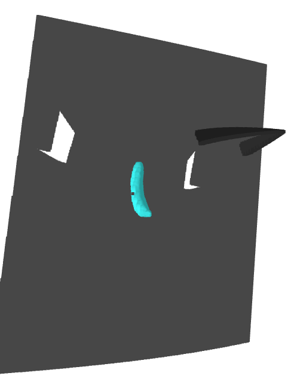

# Motion Planning for Active Viewpoint Selection in Reconstruction-Based Grasping

A pipeline in which a robot arm builds a **3D model of an object** by moving a wrist-mounted RGB-D camera along a smooth path around it, capturing views from many angles and stitching them into a single point cloud. Better 3D models lead to better grasps, so the focus is on planning a **continuous path that keeps the camera pointed at the object** for the whole motion.

Final project for **RBE 550: Motion Planning, WPI**, in collaboration with the [ELPIS Lab](https://elpislab.org/). Team project (5 members).

<!-- VIDEO: drag expansion_grr_real_ur10.mp4 here -->

---

## Overview

- **Why multiple views:** a single camera view only sees one side of an object. Fusing views from all around it gives a much more complete model of its geometry, which is what a grasp planner needs.
- **The path:** the camera follows a **semicircular path** over the object, with the end-effector constrained to always face the object, so every captured image is useful.
- **The challenge:** each point on the path can be reached by several different joint configurations. If consecutive points pick different configurations, the arm "jumps" between them and the motion is no longer smooth or continuous.
- **What we did:** compared two ways of getting a continuous path, **MoveIt Cartesian planning** and **Expansion-GRR**, and used the resulting motion to capture images and reconstruct the object with **ICP**.

---

## Method

### 1. MoveIt Cartesian planning (ROS 2)

The first approach plans the semicircle directly with MoveIt on a UR10 (`ur_ws/`).

- **How it works:** `hello_moveit.cpp` places 10 waypoints on a semicircular arc, each oriented toward the center of the arc, and passes them to MoveIt's `computeCartesianPath`. MoveIt interpolates between waypoints at a fixed end-effector step and solves IK at each point, rejecting any step where the joints jump more than a set **jump threshold**.
- **Output:** either the full trajectory, or only the fraction of it that MoveIt managed to compute.
- **Limitation:** a complete trajectory often needed many attempts (around 100), and even complete ones frequently became discontinuous partway through. Lowering the jump threshold improved continuity but made planning fail far more often. This made the approach unreliable and motivated the switch to Expansion-GRR.

<!-- VIDEO: drag moveit_continuous.mp4 and moveit_discontinuous.mp4 here, side by side -->

### 2. Expansion-GRR path planning

[Expansion-GRR](https://arxiv.org/abs/2405.13770) (Global Redundancy Resolution) builds a roadmap offline that maps each workspace pose to one consistent joint configuration. Following a path through that roadmap gives motion that is **smooth and continuous in both workspace and joint space**.

- **Path definition:** `main.py` generates a 500-point semicircle (radius 0.3 m) around the object, with each pose computed so the camera looks at the object.
- **Planning:** each pose is solved on the precomputed UR10 roadmap, starting from the previous configuration, which produces a continuous joint trajectory (`ctraj.txt`).
- **Working around a 6-DOF arm:** Expansion-GRR is designed for redundant robots, but this task fully uses the UR10's 6 joints. We handled this by shifting the semicircle around the object until a continuous solution was found.
- **Verification:** continuity was checked by measuring the joint differences between successive steps. The captured images confirmed the camera stayed pointed at the object throughout.
- **Results:** demonstrated in PyBullet and then on the real UR10.

<!-- VIDEO: drag expansion_grr_pybullet.mp4 here -->

### 3. Perception and 3D reconstruction

- **Capture:** a simulated Intel RealSense D435 on the gripper takes 12 RGB-D images at evenly spaced points along the path.
- **Point clouds:** each RGB-D pair is converted into a point cloud with Open3D (`stitcher.py`).
- **Stitching:** the clouds are aligned with **Iterative Closest Point (ICP)**, using colored ICP when colors are available, and merged into one model. Because the camera pose along the path is known, the clouds start close to aligned.

<table align="center">
  <tr>
    <td align="center"><br><em>Single view</em></td>
    <td align="center"><br><em>Stitched from multiple views</em></td>
  </tr>
</table>

---

## Results

- **MoveIt** could produce continuous semicircular trajectories, but not reliably. With the same settings (10 waypoints, jump threshold 6.28), some runs were continuous and others broke partway through.
- **Expansion-GRR** produced smooth, continuous paths with the camera facing the object throughout, both in PyBullet and on the real UR10.
- The views captured along the path were stitched into a combined point cloud of the object (a YCB banana) that covers more of its surface than any single view.

---

## Limitations and future work

- The semicircular path was chosen for simplicity. Its efficiency was not evaluated, and other curves might give an equally good reconstruction with a shorter path.
- Since the UR10 has no spare degrees of freedom for this task, Expansion-GRR occasionally failed to find a continuous solution. It should work even better on redundant arms, and its support for cyclic paths suits more constrained tasks.
- Next steps: connect the reconstruction to a full grasping pipeline, and measure reconstruction accuracy, motion efficiency and grasp success rate.

---

## Repository structure

| Path | Description |
|------|-------------|
| `main.py` | Main pipeline: builds the semicircular path, plans it with Expansion-GRR, runs it in PyBullet while capturing images, then stitches them. |
| `bullet_camera.py` | Simulated RealSense D435 that captures RGB and depth images from the gripper. |
| `stitcher.py` | Converts RGB-D images to point clouds and merges them with ICP (Open3D). |
| `Expansion-GRR/` | Expansion-GRR planner (upstream code with small changes for this project), including the prebuilt UR10 roadmaps. |
| `ur_ws/` | ROS 2 / MoveIt workspace: UR10 description, `ur10_moveit_config` and the `hello_moveit` package. |
| `011_banana/` | YCB banana model used as the target object, plus a merged point cloud. |
| `wtraj_input.txt`, `ctraj.txt`, `wtraj.txt`, `trackarr.txt` | Generated trajectory data: input workspace path, planned joint trajectory, resulting end-effector path, and solver tracking output. |
| `environment.yml` | Conda environment for the Python pipeline. |

---

## Stack

`MoveIt 2` · `ROS 2` · `Expansion-GRR` · `PyBullet` · `Open3D` · `ICP` · `Intel RealSense D435` · `UR10` · `C++` · `Python`

---

## Running it

**Expansion-GRR + reconstruction pipeline (Python):**
```bash
conda env create -f environment.yml
conda activate plan-3d-recon
pip install -r Expansion-GRR/requirements.txt

python main.py   # plans the path, runs it in PyBullet and captures images, then shows the stitched cloud
```

**MoveIt Cartesian planning (ROS 2):**
```bash
cd ur_ws
colcon build --symlink-install
source install/setup.bash

ros2 launch ur10_moveit_config demo.launch.py   # UR10 in RViz with MoveIt
ros2 run hello_moveit hello_moveit              # plan and execute the semicircle
```

See [`Expansion-GRR/README.md`](Expansion-GRR/README.md) for building new roadmaps and running the planner's own demos.

---

## My contributions

This was a team project with five members. My main contribution was the **MoveIt implementation in ROS 2**:

- **MoveIt setup:** configured MoveIt for the UR10 (`ur10_moveit_config`).
- **Semicircular trajectory:** wrote the `hello_moveit` node, which generates the semicircular waypoints facing the object and plans and executes them with `computeCartesianPath`.
- **Tuning:** experimented with the end-effector step size and the joint jump threshold to balance continuity against planning success.
- **Analysis:** identified where and why the Cartesian approach produced discontinuous trajectories, which led the team to switch to Expansion-GRR.
- **Path generation:** worked with the team on the constrained smooth path generation.

---

## Acknowledgements

- [Expansion-GRR](https://github.com/elpis-lab/Expansion-GRR): Zhong, Li & Chamzas, *"Expansion-GRR: Efficient Generation of Smooth Global Redundancy Resolution Roadmaps,"* IROS 2024 ([arXiv](https://arxiv.org/abs/2405.13770)). MIT License.
- [YCB Object and Model Set](https://www.ycbbenchmarks.com/): Calli et al.
- Built in collaboration with the [ELPIS Lab](https://elpislab.org/), WPI.

---

**Laasya Kodandaramu** · [GitHub](https://github.com/laasyak02) · [LinkedIn](https://www.linkedin.com/in/laasya-kodandaramu-085a13234/)
